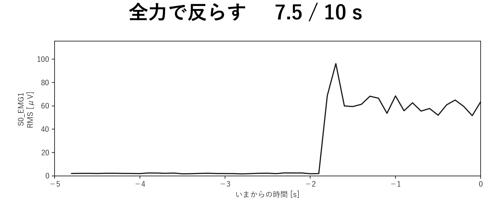

# 成果報告 2026-10-15

## 今週の目標

- **大きな目標**：EMG でデータを取り、実際に違いが出ているデータを確認する
- **小さな目標**：そのために、Trigno Discover で CSV を書き出すやり方から、Delsys API で直接記録するやり方に移す

## やったこと

- 届いた API のキーとライセンスで、自分の PC から基地局（Trigno Centro）につないだ
- 自分のコード（`emgpipe`）で、API から記録できるようにした
  - 届いた `.key`・`.lic` をそのまま置けば読むようにした
  - 今の API で接続の設定（`Configure`）が失敗するのを直した
- 記録中に、指示（「脱力」「全力で反らす」など）と筋活動のグラフを出す窓を作った
- 実機で試した（10-13、研究室）
  - センサ 1 本：10 秒（5 秒脱力 → 3 秒反らす → 2 秒脱力）
  - センサ 2 本：同時に 10 秒
  - つないだまま、安静 → 伸展 × 2 → 屈曲 × 2 の 5 回を続けて記録（本番の MVC と同じ流れ。力は入れていない）
- 論文を 1 本読んだ：Neri ほか（2021）、FPS の練習で、難しさを本人の成績に合わせて上げていくと上達が速くなるか

## わかったこと

**小さな目標への答え：API で記録できるようになった。Discover と同じ設定で取れ、筋の動きにも反応した**



- Discover と同じ設定（Avanti、2148 Hz）で記録できた。10 秒で 21,481 サンプルと、取りこぼしはなかった
- 脱力は 2 μV、反らすと 43〜46 μV に上がり、戻すとすぐ 2 μV に戻った
  - 脱力の大きさは Discover のとき（3〜5 μV）と同じくらい
- 2 本同時でも、両方のサンプル数がそろった
- つないだまま 5 回続けて記録しても止まらなかった。本番の MVC（安静 → 課題ごとに数回）を API で回せる
- 記録中の窓で、合図を見ながら取れるようになった
  - 最初の 2 回は合図がなく、いつ反らすかわからなかった。合図のない記録は使えない
- つながるまでに 3 か所でつまずいた
  - 基地局が自分の PC につながっていなかった（研究室の PC に挿さっていた）
  - センサが眠っていて、0 本と出た
  - 今の API は、使わない「同期出力」の周波数を決めないと設定が通らなかった
- センサが肌から浮くと、信号の 97% が電源の雑音（50 Hz）になり、反らしても変わらなかった。記録の前に、脱力と反らしで差が出るか見る必要がある
- 確かめていないこと
  - 6 本同時（今回は 2 本まで）
  - 数分の長い記録（今回は 10 秒まで）
  - 全力の MVC（今回は自分で反らしただけで、押さえてもらっていない）。MVC の取り方は今週は進めていない

**論文（Neri 2021）：難しさを成績に合わせて上げると、ゲーム内の成績は速く伸びた。ただし狙いの技能そのものは差が出なかった**

- 研究の背景に使う：本人の成績に合わせて練習を変えると、上達が速くなる。具体的なフィードバックで上達を促すという、この研究の考え方の裏付けになる
  - ゲームを研究している人が研究室にほかにもいるので、紹介も兼ねる
- FPS 未経験の 21 人が、CS:GO を 1 日 2 時間 × 3 週間（15 回、約 30 時間）練習した
  - 半分は普通の CS:GO（難しさは 4 段階から自分で選ぶ）、半分は難しさを 24 段階にした改造版
  - 改造版では、2 ラウンド続けて「倒した数が倒された数の 2 倍以上」になったら、実験者が 1 段上げた
- 改造版のほうが、難しさ × 成績で見た点数が速く伸びた。難しい段階まで上がった（最大で約 2.5 倍）
  - ただし、この点数は段階をかけているので、段階が自動で上がる改造版に有利。倒した数と倒された数の比そのものは、2 群で差がなかった
- 射撃場の課題（止まった的・動く的を撃つ）は、両群とも練習の前後で上達したが、群の差はなかった
- 注意や反応の速さなどの認知課題も両群で速くなり、3 か月後も残った。ただし、練習しない群がないので、練習のおかげかはわからない
- 筋電や体の動きは測っていない

## 次やること

- API で、決めたやり方の MVC を取る：確認動作 → 伸展（B）→ 屈曲（机に押し下げる）
  - `calibrate` で、記録中の窓を出しながら取れるようにする
- 6 本同時と、数分の長い記録を実機で確かめる
- ほかの箇所（肩・上腕・僧帽筋）の MVC を考える

## まとめ

- **大きな目標**：データを取る道具が、Discover の CSV から API に移った。違いが出ているデータの確認はまだ
- **小さな目標**：API で、センサ 2 本まで、つないだまま続けて記録できた。6 本と長い記録は次回

---

## 補足メモ

- **API**：Delsys が配っている、プログラムから基地局を動かすための部品（`DelsysAPI.dll`）。Trigno Discover を開かずに、自分のコードから記録の開始・停止やデータの受け取りができる。使うにはキーとライセンスが要る
- **API に移す理由**：Discover では 1 回ごとに手で CSV を書き出していて、書き出し忘れが起きた（10-06 の H）。API なら記録してすぐ保存でき、MVC の手順（`calibrate`）やエイム課題との時刻合わせもコードで扱える
- **つないだ機材**：基地局 Trigno Centro（ID 10548、ファームウェア 06-06-00）、センサ Avanti（シール番号 0 と 1）
- **キーとライセンスの置き場所**：`analysis/` に、届いた `.key` と `.lic` をそのまま置く。Git の管理外（`.gitignore`）。中身はチャットや Git に出さない
- **使い方**（`analysis/` で実行。Trigno Discover は閉じておく）

  ```powershell
  python -m emgpipe devices
  python -m emgpipe record --live --duration 10 --cues "0:脱力,5:全力で反らす,8:脱力" --session 2026-10-13 --name api_test_03
  ```
  - `--live`：記録中の窓を出す。上に今の指示と経過秒、下に直近 5 秒の RMS（0.1 秒ごと、μV）。開始前に `--lead` 秒（既定 3 秒）数える。ほかの窓より前に出る
  - `--cues`：「開始からの秒:指示」をカンマでつなぐ
  - `--session` は日付で指定する。`../data/raw/...` のような相対パスを渡すと `data/data/raw/...` に保存されてしまう（未修正）
- **`Configure` の修正**：今の DLL は、同期出力（外部機器に合図を送る機能）を使わなくても、その周波数が既定の 0 のままだと設定に失敗する。`SetSyncOutput(False, 0, False, 74)` で有効な値（37・74・148 Hz のどれか）を入れ、`Configure(False, False)`（開始・停止トリガなし）で設定する
- **窓が止まって見えた件**：最初は文字とグラフを書き換えても画面が描き直されず、指示が「脱力」のまま変わらなかった。毎回その場で描き直すように直し、記録中の画面を撮って切り替わることを確かめた。描き直しは 1 回約 0.06 秒で、記録は取りこぼさない。グラフはデータが届くまで 0.4〜0.5 秒遅れて描かれる
- **スライドの画像**：`img/2026-10-15_api_live.png` は `api_test_03` の 7.5 秒目を、窓と同じ描き方で描き直したもの（画面をそのまま撮ったものではない）
- **単位**：API も Discover の CSV も mV。コードのコメントに「API は V」とあったのは誤りで、直した
- **10-13 の記録**：`data/raw/2026-10-13/`（Git 管理外）

  | ファイル | 内容 | 結果 |
  | --- | --- | --- |
  | `api_test_01` | センサ 1 本、肌に付ける前 | ±5.5 mV の上限に 6% 張り付く。雑音だけ |
  | `api_test_02` | センサ 1 本、付けたあと、合図なし | 脱力 11〜14 μV、反らして 30 μV。雑音の 51% が 50 Hz |
  | `api_test_03` | センサ 1 本、窓の合図あり | 脱力 2 μV、反らして 43〜46 μV（0.5 秒平均の最大 51 μV） |
  | `api_test_2ch` | センサ 2 本、10 秒 | 両方 21,481 サンプル |
  | `calib_test/` | `calibrate` を短く（安静 3 秒、伸展・屈曲 2 秒 × 2、休憩 2 秒） | 5 回とも記録できた。力を入れていないので値は使わない |

  - 数値は包絡線（20〜450 Hz のバンドパス → 整流 → 6 Hz のローパス）の 1 秒ごとの平均
  - 浮いたセンサの判定：信号のうち 50 Hz とその倍数（±1 Hz）が占める割合。`api_test_03` を最初に取ったとき（画面を見ていなかった回、消去済み）は 97%
- **Neri 2021 の詳細**
  - Neri, F., Smeralda, C. L., Momi, D. ほか（2021）Personalized Adaptive Training Improves Performance at a Professional First-Person Shooter Action Videogame. Frontiers in Psychology 12:598410. doi:10.3389/fpsyg.2021.598410（オープンアクセス）
  - PDF：`literature/pdf/Neri et al. - 2021 - Personalized Adaptive Training ….pdf`（Git 管理外）
  - 改造版の難しさ：敵のボットの能力（狙いの速さ・正確さ、反応時間、連携、攻撃性、武器の得意不得意、移動の速さ）を約 100 通り組み合わせ、チームの強さ・人数・武器・マップの広さで 24 段階にした。24 段階目で基準を満たしたら 17 段階目に戻し、基準を 3 倍に上げる
  - K/D：倒した数 ÷ 倒された数。2 群で難しさの段階が違うので、K/D × 段階を「補正した K/D」として比べた（普通版の 4 段階は 1・5・7・10 段階に当てはめた）。補正した K/D では群 × 時間の交互作用あり（p = 0.017）、補正しない K/D では交互作用なし
  - 射撃場：止まった的、横・縦に動く的（2 段階の速さ）、その組み合わせ、斜めに動く的、ランダムに動く的（反射）。反射以外は前後で改善、群の差なし
  - 認知課題：視覚探索、全体・部分課題、注意の瞬き、系列反応時間、有効視野（UFOV）など。練習前・直後・3 か月後
  - 弱点
    - 段階をかけた指標（K/D × 段階）は、成績が良いと段階が上がる改造版に有利。K/D そのものは 2 群で差がない
    - 普通版の 4 段階を 1・5・7・10 段階に当てはめた根拠が書かれていない。当てはめ方で差が変わる
    - 普通版は難しさを自分で選び、改造版は実験者が上げた。「本人に合わせたこと」と「強制的に難しくされたこと」を分けられない
    - 段階は実験者が手で上げた。実験者が群を知っていたかは、読んだ範囲では書かれていない
    - 人数が 11 人と 10 人。検出力 0.93 は観察された効果量から逆算したもの
    - 認知課題の解析は、自由度 F(2,16) から逆算すると 10 人前後に見える（本文で確かめていない）
    - 対象は FPS 未経験者。タイトルは「プロの FPS」だが、プロや経験者には試していない
    - コースの時間は、改造版の群が練習前から約 30 秒遅かった。伸びしろが大きかった可能性
    - ゲームをしない対照群がない。認知の伸びが練習のおかげか、同じテストの慣れかを区別できない
    - 全体・部分課題の全体の正答率は、3 か月後に下がった（p = 0.024）。3 か月後は直後に効果が出た課題だけ測っている
    - データは「求めに応じて公開」で、公開されていない。表 1 の斜めの的の「外れ」が 938 などで、命中（71〜80）と桁が合わない
  - 背景として使うときは「練習を個人に合わせると、ゲーム内の成績が速く伸びた（有利な指標で）」まで。フィードバックやエイムの技能が伸びる根拠にはならない
- **コードの場所**
  - API との接続：`analysis/emgpipe/sources.py` の `DelsysSource`、`_load_credentials`
  - 記録中の窓：`analysis/emgpipe/plot.py` の `LiveView`
  - 記録の本体：`analysis/emgpipe/recording.py` の `record`（`on_update` で窓を更新）
